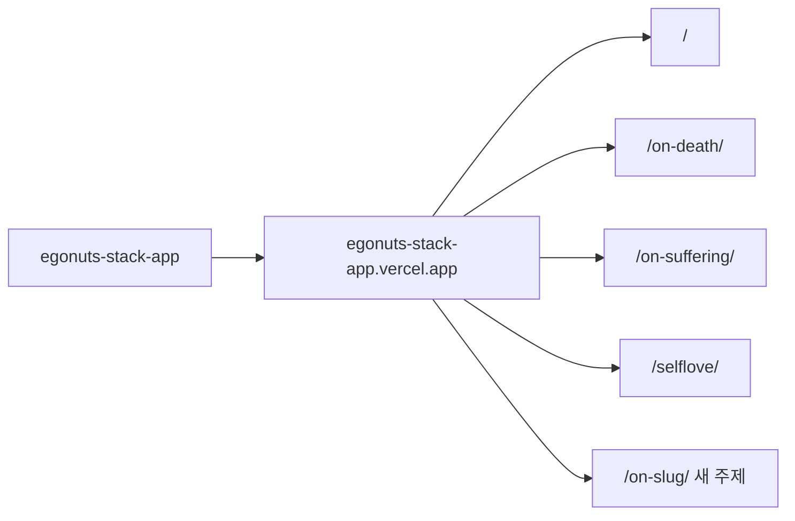

# 에고너츠 스택 — Claude / 에이전트 안내

이 파일은 `egonuts-stack-app` 루트에 둔다. 새 주제 웹 발제문을 만들거나 기존 주제를 손볼 때 **먼저 읽는다**.

## 1. 한 줄 원칙

- **카테고리 하나 = GitHub 레포 하나 = Vercel 프로젝트 하나.**
- 주제는 **하위 폴더** (`/`, `/on-death/`, `/on-suffering/`, `/selflove/`, 앞으로 `/on-<slug>/`).
- 주제마다 새 레포·새 Vercel 프로젝트를 만들지 않는다.
- 답은 **참가자 기기(localStorage)에만**. DB·Supabase 없음 (리더스클럽과 다름).
- 경험 품질 기준은 리더스클럽 「용서」급: 잡지형 표지, 질문 모션, 종이 unfold, 진행 그라데이션, 완료 화면 폴리시, OG 필수.

## 2. 배포 지도

| 경로 | 주제 | 비고 |
|---|---|---|
| `/` | 고독과 상실 | 루트가 발제문. 설정은 `rounds/solitude/` |
| `/on-death/` | 죽음에 관하여 | 폴더 독립 복사본 |
| `/on-suffering/` | 고통과 의미 | 폴더 독립 복사본 · **현행 UX 기준 템플릿** |
| `/selflove/` | 사랑과 이기심 | 옛 단독 프로젝트 편입 · DB 없음 |

라이브: https://egonuts-stack-app.vercel.app/
레포: https://github.com/0104wjdgns/egonuts-stack-app

리더스클럽(별도 레포 `thaumazein-readersclub`)은 허브+월별 폴더+Supabase. 에고너츠 코드와 섞지 말 것.



## 3. 디자인 시스템 (요약)

1. **종이 위의 생각** — 읽기 화면은 크림 종이(`#f6f0e6` 계열). 장식보다 여백.
2. **표지만 극장** — 테마 딥 컬러의 시네마틱 다크 표지 → 읽기로 내려오면 종이.
3. **색은 두 개** — `colors.main`(또는 theme main) · `colors.point`(sub). 제목 밑줄·진행바·버튼·강조에만.
4. **움직임은 장면 전환만** — 입력칸·버튼은 고요. `prefers-reduced-motion` 존중.
5. **진행 그라데이션** — `setProgress(p)`가 `--sky`를 보간. 스톱은 주제 딥색 → 크림. 휘도 < 0.55면 `body.dark`(글자 밝게), 그 위 포인트색 한가운데 구간은 `body.mid`(포인트·흐린 글자를 짙게). textarea/paper는 늘 크림 표면 위 진한 잉크.
6. **완료** — 카드 덱이 주인공. 마무리 인사는 맨 아래. `body.is-done`은 크림→테마 포인트 그라데이션.
7. **OG 필수** — 주제 폴더에 1200×630 `og.png` + `og:title/description/url/image/width/height` + `twitter:card`. 배포 후 실주소 확인. 카톡 캐시면 `?v=2`.

시그니처 모션: ① 표지 rise/draw ② 질문 번호 FLIP + 단어 단위 ③ 자료 종이 unfold ④ 진행 하늘 ⑤ (리더스클럽) 완료 점 — 에고너츠는 ⑤ 대신 카드 덱.

진행 바탕(`--sky`)과 카드 덱 색(`round.json` `colors` → `EgoTheme.palette`)은 서로 분리돼 있다. 바탕을 바꿔도 카드 색은 흔들리지 않는다.

## 4. 새 주제 레시피

1. **템플릿 복사** — 최신 UX가 반영된 `on-suffering/` → `on-<slug>/`.
2. **경로 치환** — `index.html`의 CSS/JS/og:url/og:image, `app.js`의 `BASE`·`STORE_KEY`·`ADMIN_KEY`.
3. **`round.json` 작성**
   - `title`, `date`, `colors` `{ main, point, ink?, strong? }`
   - `intro.coreLabel`, `intro.coreQuestionLines` (표지용 2~4줄)
   - `source`, `materialNote`, `imageCredit`
   - `questions[]`: `text`, `short`, `hint?`, `fields?`, `material` `{ img, txt }` 또는 `{ source }`, `finale?`
   - `closing.text`, `closing.books?`
4. **`materials/`** — 질문별 텍스트·이미지. txt 규칙: 첫 줄 제목, `"` 인용, `—` 출처, `**굵게**`, `§` 파트.
5. **SKY 스톱** — `app.js`의 `SKY`를 주제 딥색 → point → `#f6f0e6` 6~7스톱으로. 표지 `--cover-bg`, 어두운 구간 금빛(`body.dark`의 `--strong/--point`), `body.mid` 색, 완료 `is-done` 그라데이션(`style.css`)도 같은 계열로.
6. **OG** — 표지 톤에 맞춘 `og.png` 생성.
7. **README** 표에 행 추가. (나중에 허브 페이지가 생기면 링크.)
8. **로컬** — `python -m http.server 5178` → `http://localhost:5178/on-<slug>/` 를 390px·데스크톱으로.
9. **`main` 푸시** — Vercel 자동 배포. curl로 js/css/round.json/og 확인.

slug: 소문자 케밥 (`on-grief`, `on-hope`). 기존 폴더명 스타일을 따른다.

## 5. 발제문 콘텐츠 규칙

- 질문은 **직관적**. 읽고 "어쩌라고?"가 나오지 않게.
- 제안자의 의도·배경을 존중하고, 질문끼리 겹치지 않게.
- 형식 감각: `N_소주제` + `Q.` (화면에서는 큰 번호 + 질문문).
- 마지막은 **오직 나만의 이어지는 질문** (`finale` / 동등).
- 목표는 합의가 아니라 **사고의 폭을 넓히는 것**.
- 인용은 짧고 바로 와닿게. 카드에 넣을 때는 **인용 + `사람 · 책` 한 줄**. 출처 검증.

## 6. 만지지 말 것

- 다른 주제 폴더를 한 PR에서 같이 바꾸지 말 것 (요청받지 않았다면).
- 시크릿·API 키를 코드/문서에 넣지 말 것.
- 카드 덱(`cards.js`/`export.js`) 저장·공유 동작을 깨지 말 것.
- 라이브 URL 경로를 바꾸지 말 것. 옛 단독 프로젝트 리다이렉트는 별도 요청으로.

## 7. 로컬 · 배포

```bash
python -m http.server 5178
# /  또는 /on-suffering/ 등
```

빌드 스텝 없음. Framework: Other. `main` 푸시 = 배포.

## 8. 리더스클럽과의 차이 (헷갈림 방지)

| | 에고너츠 | 리더스클럽 |
|---|---|---|
| 레포 | `egonuts-stack-app` | `thaumazein-readersclub` |
| 루트 | 발제문(고독과 상실) | 허브 목차 |
| 저장 | localStorage + 카드 덱 | Supabase + 이름 선택 |
| 완료 | 내 답 카드 PNG/PDF | 제출 인원 점 + plusN |
| api/ | 없음 | `count` · `responses` (service key는 Vercel env) |

참고 구현(모션·그라데이션): `thaumazein-readersclub/season6/forgiveness/` + 그 `DESIGN.md`.
